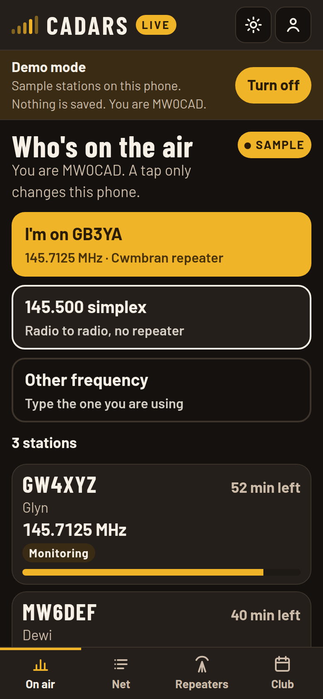
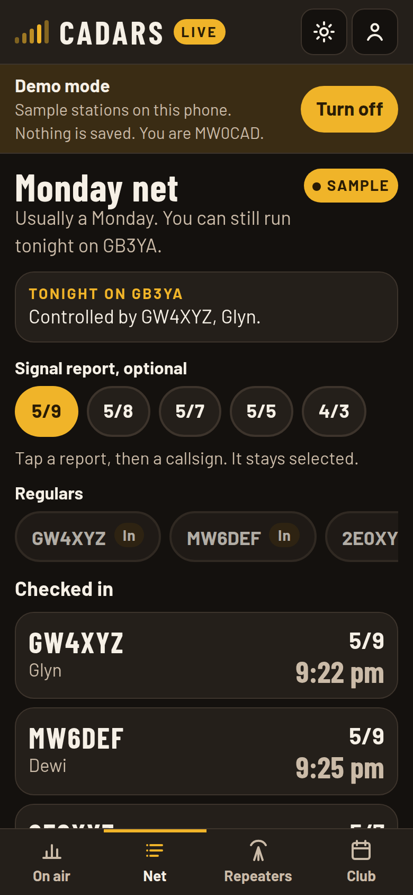
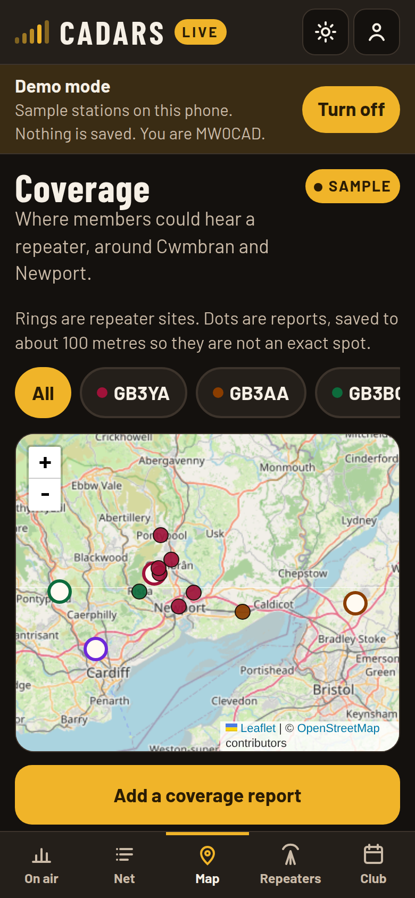
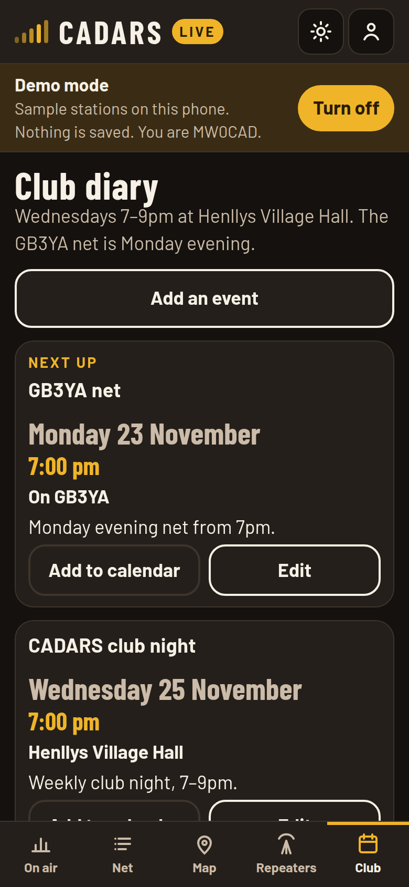
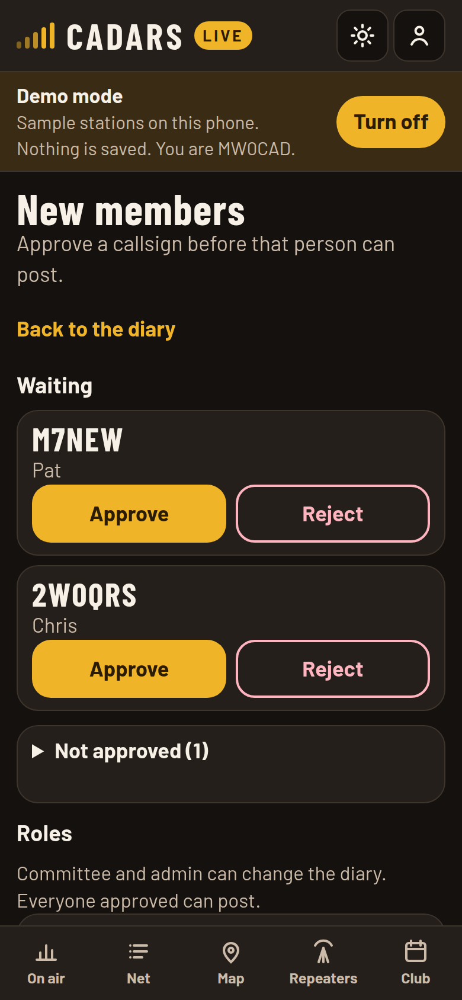

# CADARS Live

A mobile-first web app for the Cwmbran & District Amateur Radio Society. Members can see who is on the air, check in to the Monday evening GB3YA net, plot repeater coverage, and read the club diary.

It is a static site. It talks to the club's existing Supabase project, and it can be hosted free on Cloudflare Pages or GitHub Pages. Anyone can read the lists. Signing in is only needed to put yourself on the air, open a net, or check a callsign in.











## Try it at club night

The bar under the wordmark is **Demo mode**. Turn it on and the phone fills with sample stations (GW4XYZ, MW6DEF, 2E0XYZ, M7ABC). You are `MW0CAD` for the sample, acting as a committee member, so you can also drop a coverage report, edit the diary, and approve the sample members waiting on the list. Nothing is written to the club database, and the lists keep working with no signal. The map tiles still need a connection.

Turn demo mode off, and on again, to restart the sample evening.

## Run it locally

You need Node.js 20 or newer.

```bash
npm install
npm run dev
```

Open [http://127.0.0.1:43123/cadars-live/](http://127.0.0.1:43123/cadars-live/). The app is built for the GitHub Pages sub-path, so the local server uses that same prefix.

```bash
npm test          # checks callsigns, times, and the attendance badge
npm run build     # writes the static site to dist/
npm run preview   # serves that site, including the service worker
npm run check:live
```

`npm run check:live` only reads the public lists (repeaters, the next club night, and who is on the air). It does not need an account.

The public project URL and publishable key are already in the app, so a normal build connects to the club database with no extra setup. To point at a different project, copy `.env.example` to `.env` and change the two values. Do not put a secret key in `.env` or in the site.

## Add it to a phone

The site is a Progressive Web App: manifest, icons, and a service worker.

- iPhone: Share, then **Add to Home Screen**.
- Android: the browser menu, then **Install app** or **Add to Home screen**.

Once installed, the app shell and demo mode open with no connection. The live list needs a connection so it can update.

## Sign in

Reading works with no account. To post, a member enters their email and we send a code. They can type the code, or tap the link in the email on the same phone. The first time they sign in, the app asks for a UK callsign and what to call them. That row waits until a committee member approves it. Until then they can still read every list.

Apply `supabase/migrations/20261118230000_map_diary_approval.sql` in the Supabase SQL editor before using the new screens against the live database. It is safe to run once. It does not need to be run again for a normal site deploy.

Before the link will open the deployed site, add that site in Supabase:

1. Open [Authentication → URL configuration](https://supabase.com/dashboard/project/kzzqrormwligrdbrxsrw/auth/url-configuration).
2. Set **Site URL** to `https://m1k3build-collab.github.io/cadars-live/`.
3. Add these under **Redirect URLs**:
   - `https://m1k3build-collab.github.io/cadars-live/`
   - `https://m1k3build-collab.github.io/cadars-live/**`
   - `http://127.0.0.1:43123/cadars-live/`
   - `http://localhost:43123/cadars-live/`

To show the 6-digit code as well as the link, edit the Magic Link email template at [Authentication → Email templates](https://supabase.com/dashboard/project/kzzqrormwligrdbrxsrw/auth/templates):

```html
<h2>Your CADARS Live sign-in</h2>
<p>Enter this code in the app:</p>
<p><strong>{{ .Token }}</strong></p>
<p>Or tap this link on your phone:</p>
<p><a href="{{ .ConfirmationURL }}">Sign in to CADARS Live</a></p>
```

## Deploy to Cloudflare Pages

1. Push this project to a Git host Cloudflare can see.
2. Create a Pages project and choose that repository.
3. Build command: `npm run build`
4. Build output directory: `dist`
5. Node.js version: 22

No environment variables are required. The current `base` is `/cadars-live/` for the GitHub Pages address above. A site served from the root of its own domain needs `base` set back to `/` before building. `public/_redirects` is copied into `dist` so a refresh still opens the app on Cloudflare. After the first deploy, add that address to the Supabase redirect URLs.

### GitHub Pages

The public site is [https://m1k3build-collab.github.io/cadars-live/](https://m1k3build-collab.github.io/cadars-live/). The Vite `base` is `/cadars-live/`, and the manifest, service worker scope, icons, and shortcuts use that prefix.

`.github/workflows/pages.yml` builds the site and deploys it with GitHub Actions. In the repository settings, set **Pages → Build and deployment → Source** to **GitHub Actions**. The build command is `npm run build` and the published folder is `dist`. The build also copies `index.html` to `404.html`, which is how GitHub Pages serves the app on a refresh.

## Editing the diary, repeaters, and members

Committee and admin members edit the diary in the app: add, change, or delete an event, and download an `.ics` file for a calendar. Each event is two hours from its start. Club nights are Wednesdays 7–9pm at Henllys Village Hall. The GB3YA net is Monday evening from 7pm.

The same people approve or reject new members on **Review new members**, and can set another member's role. A person cannot change their own role or approval.

Repeaters are still edited in the Supabase table editor. The database now allows committee and admin to write them; everyone else cannot.

[Table editor](https://supabase.com/dashboard/project/kzzqrormwligrdbrxsrw/editor)

The app picks repeater changes up the next time someone opens that screen. No new build is needed.

**repeaters**

| Column | What to enter |
| --- | --- |
| callsign | The repeater callsign, such as GB3YA |
| location | A town or area. Not a street address. |
| output | The frequency people listen on, in MHz |
| input | The frequency the radio transmits on, in MHz |
| ctcss | The tone in Hz, or leave it empty |
| notes | A short note members should read, such as the mode |

A note that is only “Verify on ukrepeater.net before publishing” is hidden, so members are not shown an editorial reminder. Replace those notes with something useful when the details have been checked. GB3YA is pinned to the top and labelled as the club repeater. The “I'm on GB3YA” button uses the output frequency from this table (145.7125 MHz if the row is missing).

**events**

| Column | What to enter |
| --- | --- |
| title | For example, CADARS club night |
| date | The date and the start time. The app shows it in UK time. |
| location | The venue name. UK postcodes are removed on screen. |
| description | A line or two about the evening |

Do not put phone numbers or home addresses in any column. The app also strips phone numbers and UK postcodes before showing location, notes, and descriptions, but the table should not contain them in the first place.

**members**

A signed-in person can create their own row and later edit their callsign and name. The database forces a UK amateur callsign, in capitals, and stores the row as `pending` with role `member`. They cannot approve themselves or change their role. Committee or admin can set `status` to `approved` or `rejected`, and can set another person's role to `member`, `controller`, `committee`, or `admin`. Only an approved member can go on the air, open a net, check a station in, or add a coverage report.

## What the screens do

- **On air.** A live list of `on_air` rows that have not expired, updated over Supabase Realtime. “I'm on GB3YA” and “145.500 simplex” are one tap. “Other frequency” takes a typed frequency and a short note. The row lasts one hour, which the database sets. Clear removes your own rows.
- **Net.** Opens tonight's `nets` row on GB3YA, then checks callsigns in with an optional signal report such as 5/9. Regulars are the callsigns from this year's nets, most frequent first. The list updates live. Attendance counts distinct nets this year, and the most regular member gets a badge once they have been along at least three times.
- **Map.** Coverage reports and the published sites for GB3YA, GB3AA, GB3BC, GB3MG, and GB7GE, on OpenStreetMap. An approved member adds a report from the phone's location or by tapping the map, picks a repeater, and gives a signal report. The stored spot is rounded to three decimal places, about 100 metres. Filter the dots by repeater.
- **Repeaters.** Read-only list from `repeaters`.
- **Club.** The diary: upcoming events first, earlier ones collapsed, and an Add to calendar download on each. Committee members can add, edit, and delete events, and open the new-members screen.

Going on the air again replaces your previous row. A callsign can only be checked in once per net. Callsigns are stored in capitals even if someone types them in lower case.
